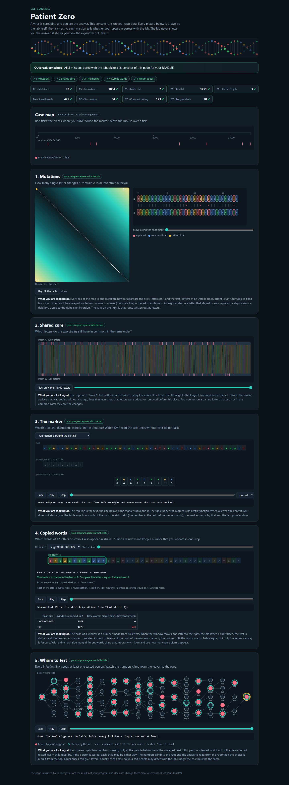

# Assignment 4. Patient Zero

Student ID: **253730**  
Name: **Kaiyrzhan Baktiyar**  
Group: **SE-2519**

## Run

Use JDK 17 or newer. Run from this project folder:

```sh
java tools/Check.java
java -cp out Main
java -cp out Bench
```

Check.java compiles the source files into out/. Alternatively, compile with `javac -encoding UTF-8 -d out src/*.java`.
The four personal files are included. Recreate exactly this variant with:

```sh
java tools/MakeVariant.java 253730 data
```

Open output/outbreak.html in a browser to explore the animations. No server or external dependencies are required.
The supplied Main, Input, Render, Generator, Bench, and lab template are unchanged.

## Program output

Personal input sizes: strain A 1,089 letters, strain B 1,085 letters, genome 27,676 letters, infection tree 79 people.

```text
Mutations: 82
Shared core: 1034
Marker hits: 7
First hit: 1271
Border length: 3
Shared words: 475
Tests needed: 34
Cheapest testing: 173
Longest chain: 20
```

The lab independently confirms all five missions and all nine output values.



## Questions

**Mission 1. What does d[i][j] mean, and how is it computed?**

`d[i][j]` is the minimum number of edits needed to transform the first i letters of A into the first j letters of B; the empty-prefix boundaries are `d[i][0] = i` and `d[0][j] = j`.
Each other cell takes the minimum of deletion (`d[i-1][j]+1`), insertion (`d[i][j-1]+1`), and replacement or matching (`d[i-1][j-1]` plus 1 for different letters, otherwise 0).

**Mission 2. Subsequence versus substring; why is Shared core larger than same-position matches?**

A subsequence preserves the order of letters but may skip letters, whereas a substring must be consecutive in both strains.
An insertion or deletion shifts later letters, so they can still belong to the common subsequence even when their indices differ; this variant has LCS length 1,034 but only 441 matching positions when comparing equal indices.

**Mission 3. Prefix function, KMP, and the marker's border.**

`pi[i]` is the length of the longest proper prefix of the pattern prefix ending at i that is also its suffix.
KMP moves forward through the text and, on a mismatch, changes only the pattern pointer using `pi[j-1]`, retaining a suffix already known to match; after a complete match this also preserves overlapping occurrences.
The marker AGCACAAGC has border length **3**, because its longest proper prefix that is also a suffix is AGC (its prefix array is `[0, 0, 0, 1, 0, 1, 1, 2, 3]`).

**Mission 4. Hash verification and many equal hashes.**

Different windows can have the same hash, so equality of hashes is only a candidate match and the code compares the letters before counting the position.
If many nonmatching windows collide, each A window may require checking many B windows, making the worst-case time O(n*m*k) instead of the usual scanning plus verification work; repeated equal windows need only the first successful comparison.

**Mission 5. Tree states, recurrence, and why greedy fails.**

For each vertex, `dp[v][0]` is the minimum subtree cost when it is untested and `dp[v][1]` is the minimum when it is tested: the first sums the tested states of every child, while the second adds cost[v] and the smaller state of each child.
Reconstruction forces each child to be tested if its parent is untested, otherwise chooses its cheaper state, starting with the cheaper root state.
A maximum-degree greedy choice can be too expensive: in a three-leaf star with centre cost 100 and leaf costs 1 each, testing the centre costs 100 while testing all leaves covers every edge for 3.

## AI use

OpenAI Codex was used to read the supplied assignment and starter, implement the missing algorithms, generate the personal data with the supplied generator, run checks and benchmarks, capture the lab screenshot, and draft this report and its explanations.
The source code and report answers in this version are AI-generated; they should be reviewed, understood, and adapted by the student before submission under the course rules.
No external code or website text was copied. The supplied starter and assignment are the basis of the implementation.
The local Git commits were created by Codex during this session and record the actual implementation stages; they do not represent independent student authorship.

## Timing (Mission 7)

Actual output of the unchanged Bench class, measured on this machine using OpenJDK 25.0.1, milliseconds averaged over three runs per size:

| test | size | time (ms) |
|---|---:|---:|
| naive search | 20,000 | 131.8 |
| naive search | 40,000 | 245.4 |
| naive search | 80,000 | 493.6 |
| KMP | 20,000 | 4.5 |
| KMP | 40,000 | 2.9 |
| KMP | 80,000 | 1.0 |
| edit distance | 500 | 13.4 |
| edit distance | 1,000 | 12.7 |
| edit distance | 2,000 | 31.1 |
| edit distance | 4,000 | 117.7 |

With the pattern fixed at 2,000 characters, naive search roughly doubles as text size doubles (1.86x then 2.01x), while KMP has linear O(n+m) theoretical growth, although these short KMP timings are dominated by JVM warm-up and do not show a reliable doubling ratio.
Edit distance is quadratic for equal-length inputs, so doubling both lengths should approach four times the work; the last doubling measured 3.78x, while smaller measurements also show warm-up noise.
The provided benchmark has no dedicated warm-up stage, and its observed times should not be mistaken for exact complexity ratios.

## Complexity

For the two-strain algorithms let n = |A|, m = |B|; for KMP let n be text length and m pattern length.
For shared words, k is the positive window length; v is the number of people. Space includes the returned result.

| algorithm | time | space | assumptions |
|---|---|---|---|
| Edit distance | O(n*m) | O(n*m) | Full prefix DP table; constant-cost character edits. |
| LCS | O(n*m) | O(n*m) | Full prefix DP table. |
| Prefix function | O(m) | O(m) | Amortized border fallbacks. |
| KMP | O(n+m) | O(m+h) | h returned occurrence positions; overlaps included. |
| Rabin-Karp (shared words) | Expected O(n+m+k+V); worst O(n*m*k) | O(m) | HashMap has expected constant-time operations; V is the number of characters compared for candidate verification. Initial hashing is O(k); each slide is O(1). Many true matches can contribute O(n*k) verification even without false collisions. |
| Tree DP: minimum-cost cover and reconstruction | O(v) | O(v) | Valid connected tree; two states per vertex, reconstruction, and recursive stack. Costs accumulated in long. |
| Tree DP: longest chain | O(v) | O(v) | Two greatest downward heights per vertex; diameter measured in edges. Stack can reach v. |

If a shared-word window is longer than either strain, the result is zero. Nonpositive window lengths are rejected.
For the general KMP helper an empty pattern matches every text boundary; the generated marker is nonempty.

## Validation

`java tools/Check.java` passed all nine lines for each supplied example: tiny, small, and dense.
Additional checks compare 500 deterministic random string pairs against exhaustive or direct reference calculations, and 300 small random trees against exhaustive vertex-cover enumeration and breadth-first path distances.
They also cover empty strings, empty and single-vertex trees, zero costs, overlapping matches, repeated shared positions, overlong windows, and two distinct 12-letter windows that share the actual rolling hash; a later genuine match in the same collision bucket is also checked.

To rerun the additional checks after compiling the project:

```sh
javac -encoding UTF-8 -cp out -d out tools/SelfTest.java
java -cp out SelfTest
```

The generated HTML was loaded in Microsoft Edge headless: all five missions agreed with the independent lab checks, no JavaScript page errors occurred, and the full-page screenshot was saved and visually inspected.

## Submission status

- Included: all source files, personal data files, full-page screenshot, generated HTML, report answers, timing and complexity tables, and explicit AI disclosure.
- Local main contains the starter commit and a separate implementation commit for each of Missions 1 through 5, followed by the report and verification work.
- Still required: review and adapt the AI-generated work as required by the syllabus, publish this repository publicly on GitHub, verify the public link, and submit that link in Moodle before the course deadline.
- GitHub publication and Moodle submission have not been performed. No remote URL or submission is claimed.
